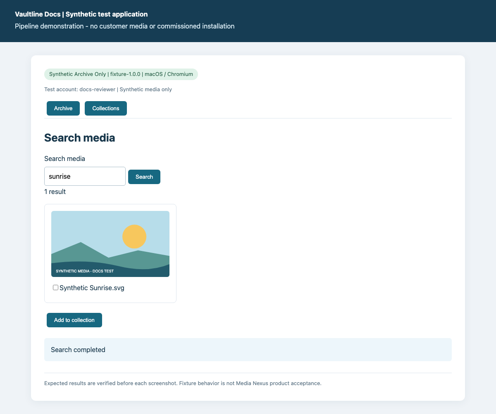
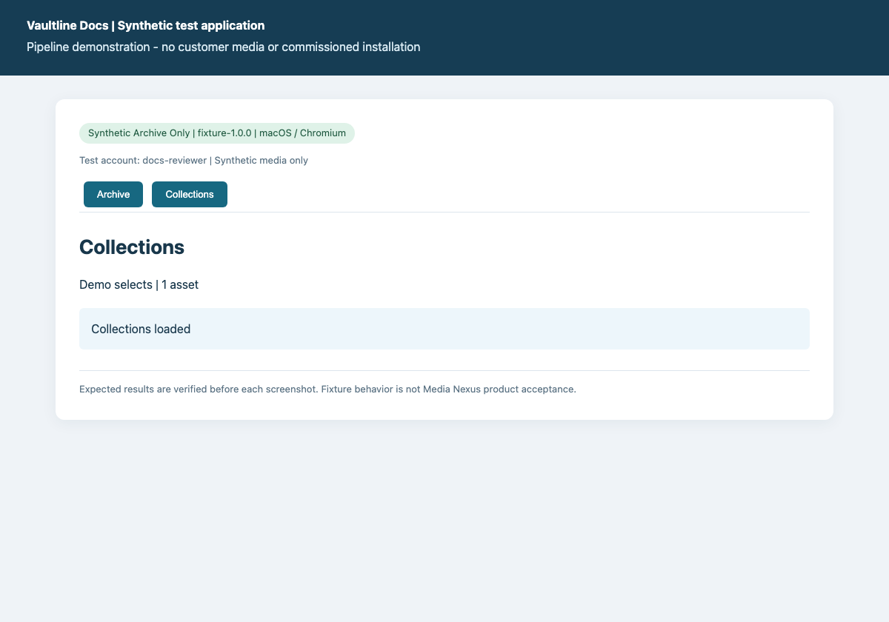

# Search the archive and create a collection

Find synthetic media and organize a selection without moving the original.

**Deployment:** Synthetic Archive Only. macOS / Chromium.

> Synthetic test fixture. These screenshots demonstrate the pipeline, not an installed Media Nexus client.

## Deployment configuration

- collections: True
- remoteTransfer: False
- workstation: Synthetic archive desk

## Prerequisites

- Sign in with the built-in synthetic docs-reviewer account.
- Archive and Collections must be enabled.

## Steps

### 1. Search media

Enter sunrise in Search media and click Search.

**Expected:** 1 result

### 2. Create and add

Select Synthetic Sunrise.svg, choose Add to collection, enter Demo selects and choose Create and add.

**Expected:** Collection created: Demo selects

### 3. Check the collection

Open Collections and verify Demo selects contains one asset.

**Expected:** Demo selects | 1 asset

## Expected result

- Demo selects contains the selected synthetic asset. The source media remains in the archive.

## Recovery

- If no result appears, check the exact search term sunrise and retry the search.
- Collection creation requires a name and selected media. Select the result before creating.

## Deployment notes

Use the collection prefix ARCHIVE- for this synthetic deployment.

## Evidence and review

- Screenshot verification: all documented fixture steps asserted in a fresh browser session.
- Source: `search-collection.json:1`; file SHA-256 `72ec54008d0c8125e3052efe05c3bbcca6f6ab3c0bc66b3f7f7aa6710e02ba29`.

Generated by Vaultline Docs. GPL-3.0-or-later. See package NOTICE, LICENSE and COPYING.
