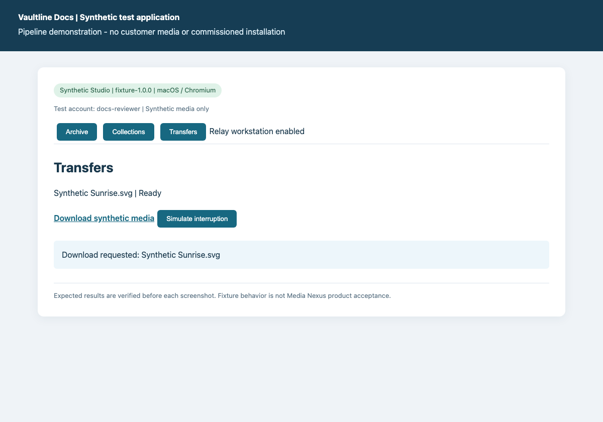

# Download selected media

Prepare and download the original synthetic media to the test device.

**Deployment:** Synthetic Studio. macOS / Chromium.

> Synthetic test fixture. These screenshots demonstrate the pipeline, not an installed Media Nexus client.

## Deployment configuration

- collections: True
- remoteTransfer: True
- workstation: Synthetic review workstation

## Prerequisites

- Sign in as the synthetic docs-reviewer.
- Remote download must be enabled.

## Steps

### 1. Prepare download

Search for sunrise, select Synthetic Sunrise.svg, choose Transfer and Prepare download.

**Expected:** Download ready: Synthetic Sunrise.svg

### 2. Download synthetic media

Choose Download synthetic media. The browser saves the synthetic SVG file.

**Expected:** Download requested: Synthetic Sunrise.svg

## Expected result

- The downloaded bytes match the source synthetic media hash, recorded in capture-evidence.json.

## Recovery

- If the transfer is Interrupted, restore the test connection and choose Resume before downloading.

## Evidence and review

- Screenshot verification: all documented fixture steps asserted in a fresh browser session.
- Source: `download-media.json:1`; file SHA-256 `ab5a5b80c51e8a15414d1277d93100f99cf80912444f7d177391d71ec281ab61`.

Generated by Vaultline Docs. GPL-3.0-or-later. See package NOTICE, LICENSE and COPYING.
