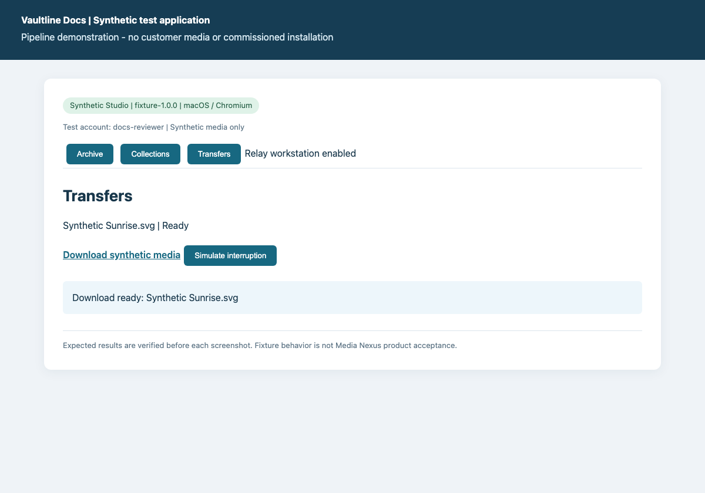
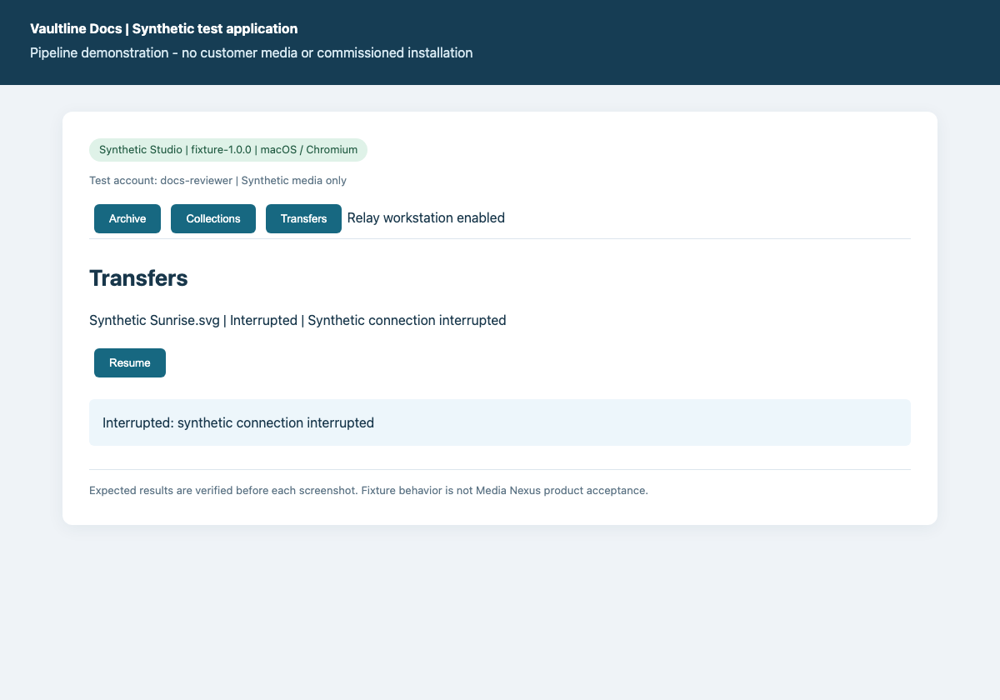

# Diagnose an interrupted transfer

Inspect an interrupted synthetic preparation and verify recovery before downloading.

**Deployment:** Synthetic Studio. macOS / Chromium.

> Synthetic test fixture. These screenshots demonstrate the pipeline, not an installed Media Nexus client.

## Deployment configuration

- collections: True
- remoteTransfer: True
- workstation: Synthetic review workstation

## Prerequisites

- Sign in as the synthetic docs-reviewer.
- Remote download must be enabled.
- Use only the fixture interruption control; do not interrupt a live customer transfer.

## Steps

### 1. Prepare a test transfer

Search sunrise, select the asset and prepare a download.

**Expected:** Download ready: Synthetic Sunrise.svg

### 2. Inspect interruption

Choose Simulate interruption and inspect the transfer status and error.

**Expected:** Interrupted: synthetic connection interrupted

### 3. Resume the fixture transfer

Restore the synthetic test connection by choosing Resume. Inspect the row before downloading.

**Expected:** Transfer ready after resume

## Expected result

- The transfer returns to Ready. This fixture does not prove native workstation copy or resumable browser-save behavior in Media Nexus.

## Recovery

- If the transfer remains Interrupted, inspect the reported error and request review. Do not claim success until Ready is visible.

## Evidence and review

- Screenshot verification: all documented fixture steps asserted in a fresh browser session.
- Source: `interrupted-transfer.json:1`; file SHA-256 `a0047bf02cac4e6f83694bfdec48da1ba5270c498c2bb25c4f2ba905bf1e0491`.

Generated by Vaultline Docs. GPL-3.0-or-later. See package NOTICE, LICENSE and COPYING.
